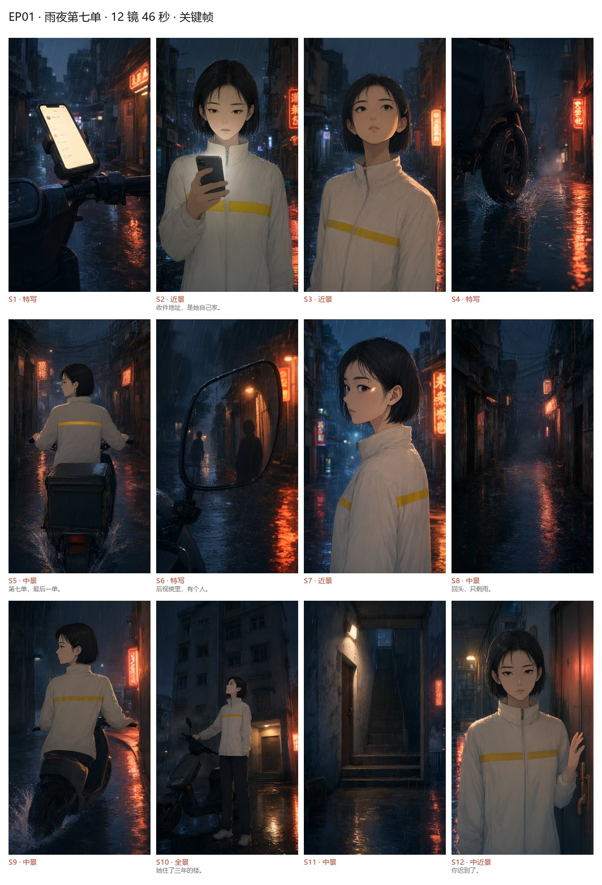
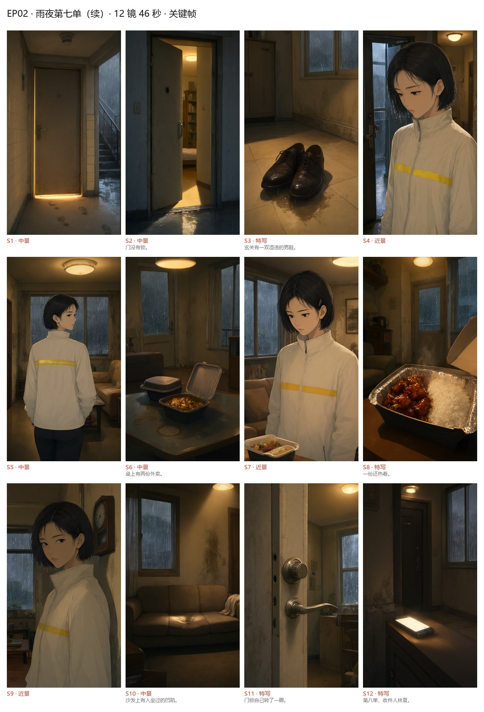
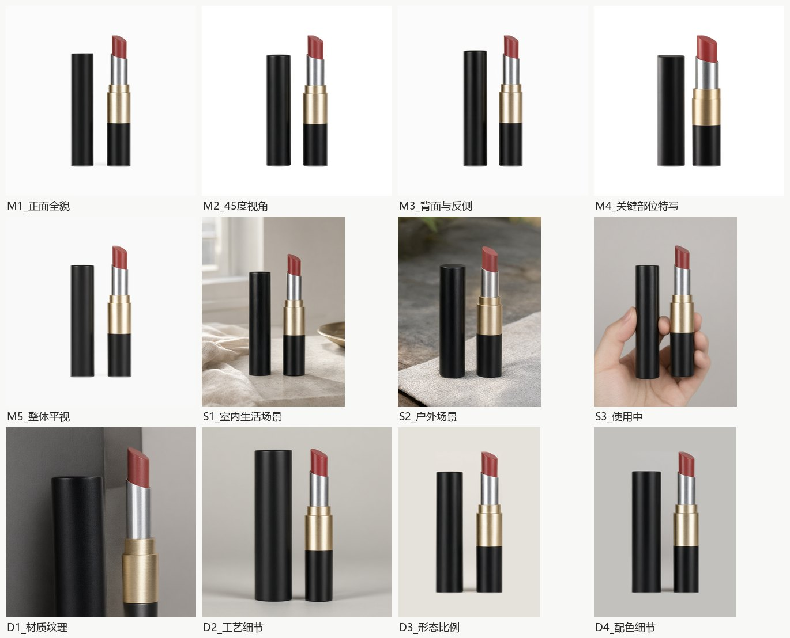

# 商品图片与漫剧生成 Agent

一套系统，两条生产线：

- **电商图片**：一张母图 → 一整套 12 张（主图 5 + 场景 3 + 详情 4）
- **漫剧**：剧本 DSL → 角色定妆稿 → 逐镜关键帧 → 图生视频 → 逐镜配音 → 环境音混音 → 成片

两条线共用同一套底层设施：**三层锁（风格/环境/比例）→ 提示词编译器 → 生成前规则门禁 → 生成后自动质检 → 版本台账**。

> 完整设计与全部实测结论见 [`AI内容生成Agent系统_实施方案_v1.md`](AI内容生成Agent系统_实施方案_v1.md)（v1.19，2400+ 行，第 7 章是逐轮实测日志，每个结论都能追到具体哪一次运行）。

---

## 先看成果

**漫剧**：两集各 12 镜 46 秒，画面 / 配音 / 环境音 / 字幕齐全。

| 集 | 成片 | 关键帧总览 |
|---|---|---|
| EP01 | [`EP01_雨夜第七单_v2.mp4`](assets/manju/ch03/versions/v2/EP01_雨夜第七单_v2.mp4)（23.5 MB） | [](docs/showcase/ch03_keyframes.jpg) |
| EP02 | [`EP02_雨夜第七单_v4.mp4`](assets/manju/ch04/versions/v4/EP02_雨夜第七单_v4.mp4)（16.8 MB） | [](docs/showcase/ch04_keyframes.jpg) |

**电商套图**：一张母图 → 一整套 12 张，五个品类。

[](docs/showcase/ecom/LS-BLACK-06.jpg)

（其余四品类：[T恤](docs/showcase/ecom/TS-WHITE-01.jpg) · [风衣](docs/showcase/ecom/JK-ORANGE-03.jpg) · [玻璃精华瓶](docs/showcase/ecom/SR-GLASS-04.jpg) · [面霜罐](docs/showcase/ecom/CR-MATTE-05.jpg)）

**几个数字**（全部有台账可查，不是估算）：

| 指标 | 值 | 说明 |
|---|---|---|
| 电商套图一次通过 | 全量 **51/60（85%）** · 可交付 **51/57（89.5%）** | 5 品类 × 12 槽；两个口径都报，见下文 |
| 漫剧单集首次生成 | **¥9.07** | 12 张关键帧 ¥2.16 + 46 秒视频 ¥6.90 + 112 字配音 ¥0.009 |
| 单集实际成本 | **¥12.4** | 差价 100% 来自返工（27%），可用门禁压低 |
| 关键帧通过率 | **83%–100%（均值 11/12）** | 换 seed 实测区间，不是单次成绩 |
| 12 镜视频并发 | **7.52×** | 154.7 s vs 串行 1162.5 s，成本不变 |
| 单价确定性 | **20 档偏差 0.00%** | 报价可以报死，不是平均值 |
| 单位算力成本 | **约 ¥12/分钟** | 行业 AI 漫剧外包 ¥100–300/分钟 |

> **仓库里没有原始产物**：`assets/` 共 859 MB（关键帧 PNG、音轨 WAV、107 个视频片段、版本归档），
> 本地保留、不入库。仓库只含代码、配置、文档、成本台账，以及 `docs/showcase/` 下的压缩展示件。
> 所有量化结论都能在对应的 `cost.csv` / `manifest.json` / 报告里追到具体某一次运行。

---

## 这份东西到底是什么（先划清边界）

它是**确定性管线**，不是自主 Agent。四条理由：

- **可复现**：锁 seed 逐像素一致（图像；视频不逐像素复现，同 seed 首帧差 2.0/255）
- **可归因**：每步输入输出落盘，失败能追到「提示词 / 模型能力 / 后处理」中的哪一类
- **成本可控**：调用次数与金额事前可算，20 个档位实测偏差 0.00%
- **可验证**：规则自检 19/19、基线冻结，改坏了会红

LLM 在这套东西里的位置是**填表**，不是**决定流程**。它写分镜、写提示词，但不决定调几次 API、不决定要不要重试。

**已知边界**（主动写，不藏）：

- 台词全是画外音，四集里没有一场双人戏 → 口型问题被分镜结构规避，代价是「角色不能开口」
- 4 张近景被画成内双，与定妆稿单眼皮不符，换 seed 无效 → 特征级模型先验，只能改基准或换模型
- 关键帧通过率 83%–100%（换 seed），不是稳定 100%
- 圆柱体商品的「背面」几何上不可得，已按分型排除、由实拍补

---

## 目录结构

```
商品图片与漫剧生成Agent/
├── AI内容生成Agent系统_实施方案_v1.md   # 主文档（设计 + 实施日志）
├── P0_结项报告.md                    # 电商单图选型与收口
├── P1_电商套图产能报告.md              # 一 SKU → 12 张成套图
├── P1_品类泛化验证报告.md              # 五品类 × 12 槽位验证（管状实测 + 按分型排除）
├── P2_迁移性测试报告.md                # 换剧本验证基础设施可复用性
├── P2_12镜正片报告.md                  # 4 镜扩到 12 镜，长序列一致性
├── P2_TTS配音报告.md                   # 配音与时长对齐
├── P2_口型对齐可行性报告.md            # 需不需要做口型、三档方案与成本
├── P2_EP02系列化报告.md                # 连续出集：环境锁变体、并发满负荷、口型被结构消除
├── P2_环境卡与常识门禁报告.md          # 环境定妆稿 + 常识六问代码化（四镜五项款式一致）
├── P2_评测基线与可观测性.md            # 指标回归、判定抖动、结构化日志（一个题面错误稳定误报 −42%）
├── .env.example                     # 环境变量模板（真实 .env 不入库）
├── docs/showcase/                   # 压缩后的展示件（成片 / 关键帧总览 / 套图一览）
│
├── config/                          # 全部配置，代码不写死参数
│   ├── prompt_locks.json            # 电商 SKU 身份锁定段 + 品类分型
│   ├── ecom_set.json                # 电商 12 槽位模板 + 品类词库
│   ├── shot_schema.json             # 分镜表单 12 必填字段 + 5 条构图规则
│   ├── manju_ch01…ch04.json                # 四个剧本（ch03=EP01、ch04=EP02，各 12 镜 46s）
│   └── _envtest.json                # 环境卡验证专用（客厅四镜，不入成片）
│
├── scripts/                         # 27 个脚本，按职责分组见下表
├── assets/                          # 全部产出与素材（859 MB，本地保留、不入库；展示件见 docs/showcase/）
│   ├── p0_testset/                  # 6 SKU 母图 + 身份特征清单 + 评分数据
│   ├── ecom_set/                    # 各 SKU 的 12 张套图 + 报告 + 一览图
│   ├── manju/ch01|ch02|ch03|ch04/    # 漫剧成片、关键帧、片段、配音、评分、**环境卡**
│   ├── manju/*/versions/            # 版本台账：四集共 14 版 + 两次作废运行
│   └── bench/                       # 五模型提示词横测原始输出
│
├── runs/                            # P0 逐次运行的落盘与成本台账
├── tools/ffmpeg/                    # 静态编译 ffmpeg（系统未安装）
└── _tmp/                            # 会话期间的临时调试图，可随时删（不入库）
```

### scripts 索引

| 分组 | 脚本 | 作用 |
|---|---|---|
| **电商套图** | `ecom_set.py` | 一条命令出 12 张，含自动质检 |
| | `fit_white.py` | 白底归一化：裁到主体 → 缩放 → 居中（零依赖；尺度按最长边，目标 70%、实测 0.69–0.73） |
| | `postprocess_canvas.py` | cv2 版画布合成 + 合规门禁（缺 cv2 时自动降级） |
| | `set_summary.py` / `set_sheet.py` | 跨品类汇总 / 单套 4 列一览图 |
| **电商 P0 评分** | `p0_freeze_baseline.py` | 冻结基线，换模型时检测退化 |
| | `p0_prepare_assets.py` | 母图预处理：去水印、修复瑕疵、裁切出 `ref_front.png` |
| | `p0_make_scorecard.py` | 由 `identity_sheet.json` 派生评分卡三件套（清单 / 运行登记表 / 打分长表）|
| | `p0_fill_scores.py` / `p0_recalib.py` | 算分 / 比例与色相客观校准 |
| | `run_batch.py` | 批量执行器（多 SKU × 多任务） |
| **漫剧** | `manju_run.py` | 定妆稿 / **环境卡** / 关键帧 / 图生视频 / 配音 五阶段（空镜 `has_person=false`；视频 `--concurrency` 并发；环境卡 `--envs` 指定） |
| | `manju_tts.py` | 逐镜配音 + 时长对齐（台词超预算时 lint 先拦） |
| | `make_ambience.py` | 环境音确定性合成（雨/室内/街道），**不依赖任何素材** |
| | `manju_assemble.py` | 字幕 + 音轨混合（ducking + 响度标准化）+ 拼接 |
| | `manju_score.py` | 角色一致性评分（可回评历史版本） |
| | `manju_gate.py` | 关键帧手部/面部高危区拼图（10 秒人工过） |
| **提示词引擎** | `compose_prompt.py` | 表单 → 提示词，违规**直接拒编** |
| | `manju_lint.py` | 生成前规则门禁，`--selftest` 注入历史事故验证 |
| **质检** | `manju_vlm_check.py` | VLM 质检（关键帧 + 视频抽帧）；题面只问"有没有"，不判类别 |
| | `eval_run.py` | 评测基线：规则自检 / 单价确定性 / 判定抖动 / 换 seed 波动（`--baseline` 冻结） |
| | `runlog.py` | 结构化运行日志（JSONL）+ 查询：哪条规则最常报、钱花在哪个 stage |
| | `mouth_check.py` | 唇形运动检测：画外音镜头该不该动嘴，量化判定 |
| **引擎** | `compose_prompt.py` | 三层锁 + 空镜开关 + **环境锁变体**（`form.env_variant` 必填）+ **环境卡 canon 注入** |
| **工具** | `get_ffmpeg.py` / `doc_check.py` / `probe_video.py` / `prompt_bench.py` | 环境与自检 |
| | `make_showcase.py` | 生成 `docs/showcase/`：关键帧总览、套图一览、角色/环境卡压缩版 |
| | `qwen_tts_client.py` | TTS 客户端（qwen3-tts-flash），`--list-voices` 看音色 |

---

## 环境

Python 3.11+，外部依赖只有两个：

```bash
pip install -r requirements.txt      # Pillow + numpy
python scripts/get_ffmpeg.py         # 仅漫剧成片需要；系统已装 ffmpeg 则跳过
cp .env.example .env                 # 填 PROVIDER_API_KEY（阿里云百炼）
```

**没有 API Key 也能先验证代码**——自检、编译校验、文档一致性、单价确定性全部是纯本地的：

```bash
python scripts/manju_lint.py --selftest                 # 规则门禁：注入 19 个历史事故，漏一条就红
python scripts/compose_prompt.py --config config/manju_ch04.json --check
python scripts/doc_check.py                             # 版本号 / 章节日期 / 孤儿文件 / 报告引用
python scripts/eval_run.py --suite lint --suite cost_determinism
```

CI（`.github/workflows/checks.yml`）跑的就是这四条。

---

## 快速开始

```bash
# 电商：一套 12 张（自动归一化 + 自动质检）
python scripts/ecom_set.py --sku CR-MATTE-05
python scripts/ecom_set.py --sku CR-MATTE-05 --slots M1 S1 D1   # 只跑指定槽位
python scripts/ecom_set.py --sku CR-MATTE-05 --recheck          # 只重判不重生成（花钱，会引入判定抖动）
python scripts/ecom_set.py --sku CR-MATTE-05 --restate          # 只按新配置重算分母（零成本，不动判定）
python scripts/set_summary.py                                    # 跨品类汇总

# 漫剧：一集全流程（以 12 镜正片 ch03 为例；ch01/ch02 同一条命令只换 --config）
python scripts/manju_lint.py --config config/manju_ch03.json   # 生成前门禁（0 error 才继续）
python scripts/manju_run.py --config config/manju_ch03.json --stage character
python scripts/manju_run.py --config config/manju_ch03.json --stage environment   # 环境卡（脚本内景必跑）
python scripts/manju_run.py --config config/manju_ch03.json --stage keyframe --candidates 3
python scripts/manju_vlm_check.py --config config/manju_ch03.json --batch   # 视频贵 4 倍，先查关键帧
python scripts/manju_run.py --config config/manju_ch03.json --stage video --concurrency 12   # 视频（并发）
python scripts/manju_run.py --config config/manju_ch03.json --stage voice   # 配音
python scripts/manju_assemble.py --config config/manju_ch03.json --ver v2   # 有声成片（含环境音）
# 换下一集只改 --config：config/manju_ch04.json 就是 EP02（同角色、同世界观、室内戏用 env_variant）
python scripts/manju_score.py --file assets/manju/ch03/consistency_scores.json

# 配音与音频单独调试
python scripts/manju_tts.py --config config/manju_ch01.json --dry-run  # 只算字数预算，不花钱
python scripts/qwen_tts_client.py --list-voices                        # 看可用音色
python scripts/make_ambience.py --list                                 # 看环境音类型
python scripts/make_ambience.py --type rain_night_alley --duration 16 --out _tmp/rain.wav

# 自检与评测
python scripts/eval_run.py --all                # 规则 + 单价 + 判定抖动（约 ¥0.6）
python scripts/eval_run.py --baseline           # 冻结为基线，下次跑自动比对退化
python scripts/runlog.py --summary              # 各 stage 成败与花费
python scripts/runlog.py --top rule             # 哪条规则触发最多
python scripts/doc_check.py                     # 文档与代码是否同步
python scripts/manju_lint.py --selftest         # 历史事故是否仍被拦住
python scripts/compose_prompt.py --check        # 四镜能否编译
python scripts/mouth_check.py --config config/manju_ch03.json   # 画外音镜头的嘴该不该动
```

---

## 当前成绩

| 线 | 指标 | 结果 |
|---|---|---|
| 电商单图（P0） | 6 SKU 稳定可用 | **5/6**，平均保真 0.926 |
| 电商套图（P1） | 5 品类 × 12 槽自动通过 | **全量 51/60（85%）· 可交付 51/57（89.5%）**，单套 ¥2.16 / 约 4.7 分钟 |
| 漫剧（P2） | EP00 一致性 | 3/4 镜可用，均值 0.875（v1 基线） |
| | **12 镜正片（EP01）** | **12/12 片段一次过、46 秒成片**（指接口调用全成功，非质检通过）；带身份镜 4/7 过线、均值 0.904，**不随长度衰减** |
| | **EP02 续集** | 同角色零漂移复用定妆稿，**只加一份 config**；12/12 一次过、46 秒（同上口径）；口型问题被分镜结构消除 |
| | **环境卡** | 客厅/玄关各一张；四镜**五项款式一致**（EP02 旧版沙发/窗/茶几各 2 种）；窗格数 2–4 仍不稳 |
| | 常识门禁 | 六问里五问进代码，规则 **24→29 条**、自检 **19/19** |
| | **评测基线** | 规则 19/19、**单价 20 档偏差 0.00%**、VLM 判定（hard 项）一致 100%；关键帧换 seed **83%–100%（均值 11/12）** |
| | 视频并发 | 2 镜 **1.99×**；**12 镜满负荷 154.7 秒 vs 串行 1162.5 秒 = 7.52×**，成本完全相同 |
| | 常识修正 | v4 修掉「室内下雨」与「门框立在空地上」，`rain_scope` 变成编译器必填 |
| | 迁移性（换剧本） | 首轮 **2/3 可用、零返工**；12 镜扩集只加一份 config |
| | 配音（TTS） | 两集 **6/7 镜有台词**，102 字共 ¥0.0095，零截断、零变速 |
| | 混音 | 环境音合成 + ducking（实测 7.6–9.3dB）+ 响度 **-16 LUFS**，信噪比 14.9–18.6dB |
| | 口型审计 | 12 句台词**全为画外音**→ 0 镜需要口型对齐；仅 S2 唇动 55%（应修正分镜） |

累计花费约 **¥64.3**，全部可在台账里逐笔核对（漫剧四集 ¥48.3 + 电商套图 ¥10.6 + 电商单图 ¥2.5 + 探针与横测 ¥2.3；配音 ¥0.03 可忽略）。
本轮环境卡与常识门禁花 ¥1.44 / 6 次调用，**零返工**；其中 ¥0.18 是故意买一个否定结论（环境卡图当参考图有害）。

---

## 几条硬约束（都是踩坑换来的）

1. **`.env` 不进代码、不进日志、不进前端。** 已在 `.gitignore`。
2. **同名 seed 完全确定，重试必须换 seed**；换 seed 只改局部细节，改不了结构解读。
3. **否定式提示词反向强化。** 写「不得出现泪水」等于请模型重点渲染泪水。要改结构（换景别/换机位），不要堆否定词。
4. **关键帧干净 ≠ 成片干净。** 视频模型会在运动中自己加东西（泪痕、液体外流、月亮）。质检必须查视频抽帧。
5. **约束的单位必须与测量的单位一致。** 提示词写「高度 65%」，就别拿「面积占比」去判。
6. **VLM 只判「有没有」，不判「是什么类别」。** 「有几只手」「能不能看到完整轮廓」可靠；「是不是微距」「朝前还是朝后」不可靠。
7. **占比/版式由确定性后处理保证，不靠模型自觉。** 模型对「占多大」没有稳定控制力。
8. **任何「看起来像缺陷」的判断，先在原分辨率量化或放大，再下结论。** 这条栽过 4 次。
9. **台词的字数预算是整套里唯一能在生成前算准的量。** TTS 按字出音、视频按整秒出片，天生对不上；
   写剧本时就按 4 字/秒卡住，比事后变速或重跑视频便宜 100 倍。
10. **混音先问"比人声低多少"，不是"电平调到多少"。** 环境音 -26dB 看着合理，但人声也是 -25.7dB——
   一样响就等于没有环境音，只有噪声。
11. **运动描述不写递进（"越……越……""逐渐……"）。** 模型会把趋势推到极端：写「眉心越收越紧」，
    4 秒后变成怒目露齿。要写静态状态（发怔、绷着），不要写变化过程。
12. **不写水与物体的交互**（"水花溅开""泛起涟漪"）。模型会画成白色同心圆线稿和放射细线。
   只写"驶向巷子深处"，画面自然有水。
13. **规则要按领域分，不能跨领域复用。** 电商商品图禁一切可读文字（标签乱码毁可信度），
    漫剧叙事画面恰恰相反——夜巷需要招牌看起来像招牌，要禁的只是可辨识的真实词句/品牌名/门牌号。
14. **一致性均值不能跨集比较。** ch01 四镜全带脸均值 0.875，ch03 七镜带身份均值 0.904 反而更高，
    但带脸四镜只有 0.845。分母的镜头类型构成不同，只能比同类镜头。
15. **抽象物理现象会被画成图形符号。** 写「热气上升」得到浓白卡通团块 + 盒底橙红火光（读作着火），
    和「水花溅开 → 同心圆线稿」同源。要表达热/冷，写静态证据：盒盖内侧的水珠、菜上的油光。
    门禁 `SYMBOL_MOTION` 会拦，允许带理由的 `symbol_accepted` 豁免。
16. **描述「世界此刻长什么样」属于环境，描述「它被怎么画出来」才属于风格。** EP01 的 `style_lock`
    混着"冷蓝夜色/霓虹暖橙/湿面高反光"，一进室内就全错。环境锁做成具名变体（走廊/室内），
    每镜必须点名，冷暖调色也归环境。
17. **台词镜与带脸镜解耦，口型问题在结构上就不存在。** EP02 七句台词全落在空镜、四个带脸镜全无声，
    成本零增加。先把分镜写对，比接对口型模型便宜四个数量级。
18. **一个镜头连续两次不如预期，先判断是不是模型的固定画法。** 是的话改描述没用，
    **改节拍**才有用：S11「门缓缓合拢」两次都出"门半开"，改成「反锁旋钮自己转一格」一次就对。
19. **凡是会充满画幅的东西（雨、雪、雾、烟），必须同时写明它在画面哪一侧、哪一侧是相反状态。**
    只写「雨幕清晰」，模型就把雨涂满整张画面——EP02 S2 因此变成"屋里下雨"。
    现在 `rain_scope` 是编译器必填字段，缺了直接拒编。
20. **质检必须有一问是对着常识问的，不是对着配置问的。** 设定本身可能自相矛盾（要雨，但空间是室内）。
    六条常识清单：围合（顶/墙/地）、天气归属、地面干湿、接缝是否悬空、进深是否空旷、道具件数与朝向。
    其中五条已进代码（`SPACE_ENCLOSURE` / `RAIN_SCOPE` / `SURFACE_ANCHOR` / `DEPTH_MARK` / `PROP_UNSTRUCTURED`）。
21. **详细不会自洽，结构才自洽。** 同一个物件在两处都写得很清楚、但写的不一样，模型会**两个都画**——
    S6 的 `space` 写「玻璃茶几」、环境卡写「深红木矮茶几」，成片里出现两张茶几。
    冲突由 `CANON_MATERIAL_CONFLICT` 拦。改稿时先问"这和环境卡冲突吗"，而不是"这条够不够细"。
22. **环境卡要写「物件属性」，不要写「平面布局」。** 「东墙的沙发」模型用不上；
    「米色布艺三人沙发、靠墙、扶手磨白、中间坐垫凹陷」每镜都用得上。布局只在广角镜有效，属性每镜都有效。
    另外**环境卡图不要当参考图**：它是广角全景，传进去会把构图与左右关系强加给每一镜
    （实测同一镜两版，沙发/窗的左右直接互换）。空间方位只能由文字表达，图只负责质感与配色。
23. **环境卡锁得住「材质/颜色/有无配件」，锁不住「格数/件数/颗数」。** 写「三格木框推拉窗」，
    四镜给出 2/3/3/4 格。这和第 7 条是同一个病：模型对**数量**没有稳定控制力。
    要锁数量只能靠后期或区域约束模型，再写一遍"三格"没用。
24. **身份锁定段里不要混构图。** `locks` 写「两件平行并排、底端对齐、间距 1.5 倍管径」，
    微距槽位再怎么要求"完整轮廓不入画"都无效——**两处都很清楚，模型就两处都照做**（同第 21 条）。
    属性（材质/颜色/比例）与构图（方位/件距/朝向）必须分开注入，微距槽位只给属性。
25. **当一个指标的分母可以被人调整时，调整动作必须留下痕迹。** 排除某个槽位要有三条边界：
    几何上必然失败（圆柱体的「背面」）才排除、不稳定但能做到的不排除、提示词自相矛盾的去修配置。
    报告必须同时给**全量口径**与**可交付口径**两个数字，并列出 `excluded` 与理由——
    否则「89.5%」和「造假」在文件层面无法区分。

---

## 已知限制

- 模型对**指定视角/景别**遵循度低：要背面给正面、要微距给整体。这是当前最主要的残留缺陷（电商 4/57 张微距仍是整体、漫剧大特写一致性 0.700）。
  唯一确认**几何上必然做不到**的是圆柱体商品的「背面」（正反面等价），已按分型排除、由实拍补。
- 漫剧**只有单角色、没有对白**：四集 12 镜里没有一场双人戏，台词全部是画外音。
  口型问题因此被分镜结构规避，代价是"角色不能开口说话"——**现在的产物是配旁白的动态插画，还不是剧**。
  要跨过去得做双人同框（多角色一致性未验证）+ 口型（可灵 ¥0.10/秒），建议先用 4 镜探路（¥4–6）。
- VLM 质检的「文字」项不可靠，目前只作提示，不计入通过率。真正做法需与母图比对或 OCR。
- `postprocess_canvas.py` 依赖 `cv2`，本机 PyPI 不可达装不上，走 `fit_white.py` 降级；复杂背景抠图仍需 cv2。
- 参考图本身是 AI 生成的，评分可外推性有限；商用前需补真实手机拍摄素材。
- 漫剧**环境音是合成的，不是录音**：压在 -34dB 下做氛围够用，但"雨点打在伞面"这类可辨识的具体音效合成不出来，仍需真实素材库。
- 漫剧**无 BGM**：准确说法是——百炼的 `fun-music-v1`（¥0.002/秒）**存在但处于邀测**，而且它是**会写词演唱的歌曲模型、没有纯器乐模式**，当台词下的 BGM 会撞人声。缺的不是能力也不是素材，是「能出器乐的模型」。
  混音链留了 `ambience.bgm` 字段，拿到素材或邀测权限即可接入（详见主文档 7.22）。
- 漫剧**无口型对齐**：但当前三集 12 句台词全是画外音，**没有一镜要求角色开口**，所以不是现存缺陷。
  唯一例外 S2（旁白在响而唇在动，55% 帧有变化），修法是让她闭嘴（¥0.78）而非上口型。
  真要做"角色开口"：EMO ¥0.16/秒（512×704，1800 秒免费额度）或可灵 ¥0.10/秒，详见 `P2_口型对齐可行性报告.md`。
- **首尾帧串联未做**：要换 `wan2.7-i2v`（¥0.60/s，4 倍价），只在「同场景连续动作」有收益，暂不划算。
